# 2. Концепция применения: требования, декларативная, функциональная и процессная модели

*Разработка концепции (ГОСТ 34.601-90, стадия 2; ГОСТ Р 57193-2025, пп. 6.4.2–6.4.3).* Требования выведены из правил и сценариев §1. Декларативная модель (ER) и модель функционирования (DFD) построены согласованно: каждый документ DFD раскладывается на атрибуты ER, каждое обращение к хранилищу — на её сущности и связи. По листьям функций построена процессная модель (BPMN).

<!-- include: 02-requirements.md -->

## 2.2. Декларативная модель (ER, нотация Чена)

Одна предметная область — одна диаграмма, в ней две части («лингвистический минимум БД» и «системы оценивания качества»).

- **Синий контур — хранится в БД:** 16 сущностей, 24 связи; D1–D4 на DFD — её логические части, физически одна база PostgreSQL.
- **Коричневый контур — система оценивания качества** (в БД не хранится): пользователь *пользуется* программой; программа *выполняет* функции и *обладает* качеством; функция *оценивается* частным критерием, критерий *вычисляется из* показателей; качество *складывается из* критериев и общих показателей (§1.3, §5.7).
- **Особые случаи:** 1:1 — r16 «билет возвращается», r17 «билет погашается» (R13, R15); M:N — r05 организаторы мероприятия, r06 сотрудники с ролью, r07 артисты; r24 — возврат по платежу заказа (R23); проход и попытка сканирования — отдельные сущности: проход ровно один на билет, попытки — журнал.
- **Межсущностные правила** (не видны на ER) — место из зоны билета, зона из зала мероприятия (R06); один живой билет на место (R01): ограничения и триггеры БД (§4.4).

Таблица: Отражение правил в ER-модели

| Правило | Отражение в ER |
|---|---|
| R01, R11, R12 | Билет: код доступа, статус; r12, r14 |
| R02, R07, R08 | Заказ: статус, «бронь до»; Билет: цена и скидка |
| R03, R04, R14, R16 | Мероприятие: начало, окончание, окно продаж, статус |
| R05 | Продаваемая зона (r08, r09, r13) — цена пары «мероприятие — зона» |
| R06, R20 | r01, r02, r04, r14 |
| R09, R21 | Промокод: срок, лимит; r11, r23 |
| R10, R22 | Платёж: ID транзакции сервиса, статус |
| R13, R15, R17 | r16, r17 (1:1) |
| R19 | r05, r06 (роль) |
| R23 | r24 «Платёж возмещается возвратами» |

## 2.3. Модель функционирования

**МФ = ⟨КД; ДДФ; ⟨ДПД⟩⟩**, нотация Гейна–Сарсона. Коды: E — внешние сущности, F — функции, D — хранилища, P / I — внешние / внутренние документы, Q / A — запрос / ответ к хранилищу (синяя / зелёная стрелка). Хранилища логические, физически — одна база.

### 2.3.1. Контекстная диаграмма

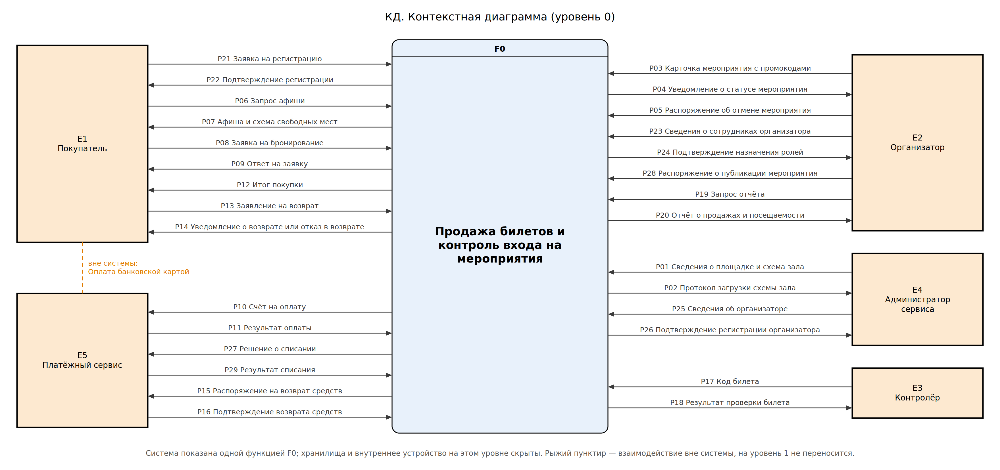

Система — одна функция F0; 15 входящих и 14 исходящих документов. Оплата картой идёт между покупателем и банком вне системы (рыжий пунктир).

### 2.3.2. Декомпозиция функций и спецификация листьев

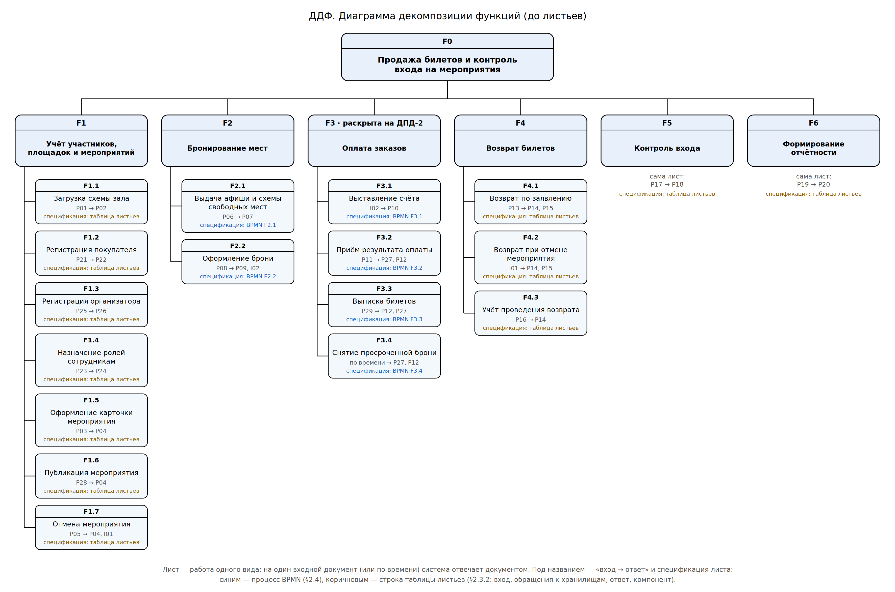

Дерево раскрыто до листьев. **Лист** — «пользователь спросил — система ответила»: на один входной документ (или по времени) — ответ. Спецификация листа — строка таблицы: вход, обращения к хранилищам, ответ, компонент; для листьев покупки — ещё процессы BPMN (§2.4).

Таблица: Спецификация листьев дерева функций

<!-- include: generated/leaves.md -->

### 2.3.3. ДПД уровня 1

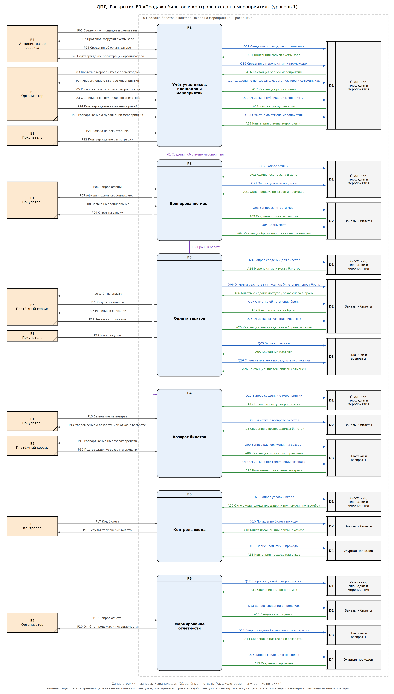

**Хранилища** (каждое нужно двум и более функциям): D1 участники, площадки и мероприятия — пишет F1; D2 заказы и билеты — F2, F3, F4, F5; D3 платежи и возвраты — F3, F4; D4 журнал проходов — F5; F6 читает все. **Баланс:** внешние документы уровня 1 совпадают с контекстной диаграммой по каждой внешней сущности (15 + 14); I и Q/A — внутренние, в баланс не входят.

### 2.3.4. ДПД уровня 2 (раскрытие F3 «Оплата заказов»)

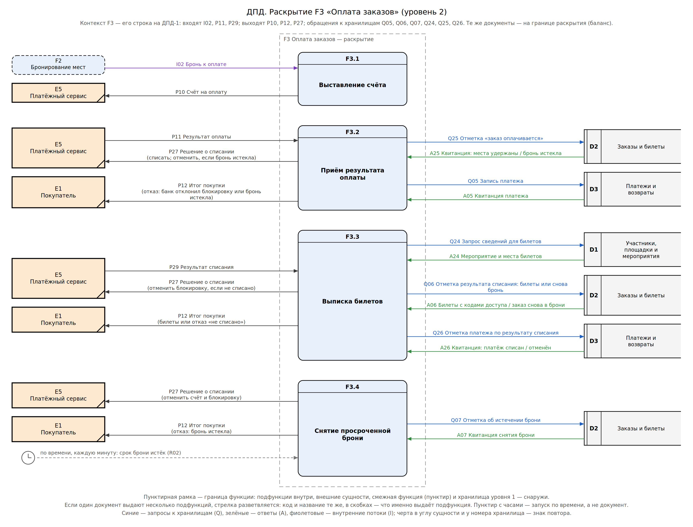

- Раскрыта оплата: в ней двухстадийная оплата и таймер брони.
- Граница = строка F3 на ДПД-1 (баланс): входят I02, P11, P29; выходят P10, P12, P27; обращения Q05, Q06, Q07, Q24, Q25, Q26.
- Один документ от нескольких подфункций — стрелка разветвляется, в скобках — что выдаёт подфункция. F3.4 запускается по времени (часы).
- Подфункции связаны через хранилище D2: F3.2 ставит заказу «оплачивается», F3.3 — «оплачен» или снова «бронь», F3.4 снимает просроченные брони; заказ «оплачивается» по сроку не снимается — место держится до ответа банка.

### 2.3.5. Состав документов

Состав получен **газетным анализом**: документ читается как бланк, поле за полем, и каждое поле относится к атрибуту ER. Для каждого поля задаётся один из трёх вопросов:
1. поле входящего документа — куда оно записывается или по какому атрибуту идёт поиск;
2. поле исходящего документа — откуда функция его берёт: из ответа своего обращения к хранилищу, из пришедшего документа или вычисляет;
3. у каждого атрибута ER есть источник — входящий документ или сама система (статусы, «бронь до», код доступа).

Так найдены обращение Q24 (сведения для билетов) и документы P21–P26 (регистрация и роли). Пример — P08 «Заявка на бронирование»:

Таблица: Газетный анализ документа P08 «Заявка на бронирование»

| Поле | Атрибут ER |
|---|---|
| мероприятие | Мероприятие.ID мероприятия |
| места | Место.ID места |
| ФИО держателей | Билет.ФИО держателя |
| промокод | Промокод.Код |
| телефон, email | Заказ.Контактный телефон, Заказ.Контактный email |

Состав всех документов — приложение А.

## 2.4. Процессная модель (BPMN)

Процессная модель показывает порядок работы во времени и точки принятия решений. Она состоит из **пути пользователя** — что делает покупатель, без внутреннего устройства программы, — и **процесса программы на каждый его запрос**: один процесс — одна операция «запрос → ответ», выполняемая конкретным компонентом над конкретными данными. Процессы построены для покупки (листья F2 и F3); остальные листья специфицированы таблицей §2.3.2.

Обозначения (BPMN 2.0):
- развёрнутый пул — процесс, показанный на листе; прямоугольник с серой полосой — свёрнутый пул: участник или другой процесс;
- сплошная стрелка — порядок действий внутри процесса; пунктир — сообщение между пулами, на нём код и название документа DFD;
- у действия программы — компонент [Kn]; под действием — группа данных с парой «запрос Q / ответ A»; рядом — объект данных с состоянием («Заказ [бронь]»);
- круг с конвертом — начало по сообщению или «получено сообщение»; толстый круг с конвертом — конец с отправкой; круг с часами — запуск по времени; ромб с крестом — выбор пути; ромб с пятиугольником — ожидание одного из нескольких ответов.

Число обращений к БД в процессах (10) равно числу пар Q/A функций F2 и F3 на DFD, каждая пара встречается один раз — в процессе своего листа.

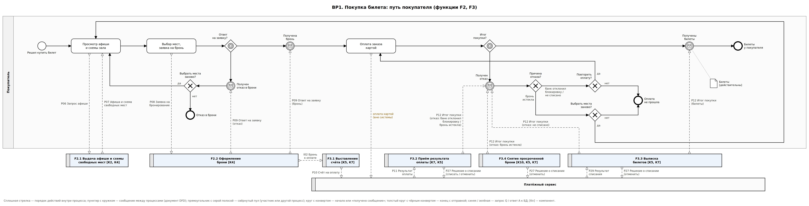

**BP1. Путь покупателя.**
1. Покупатель запрашивает афишу (P06) и получает схему свободных мест (P07).
2. Отправляет заявку на бронь (P08) и ждёт ответа (P09): бронь или отказ. При отказе — «Выбрать места заново?»: да — снова к афише, нет — «Отказ в брони».
3. С бронью платит картой на странице платёжного сервиса (вне системы) и ждёт «Итог покупки» (P12): билеты или отказ.
4. По причине отказа: «банк отклонил блокировку» или «не списано» — бронь жива, «Повторить оплату?»; «бронь истекла» — «Выбрать места заново?».
5. Ссылку на оплату покупатель получает запросом к программе (API09 — ссылка на счёт, уже выставленный F3.1), а «Итог покупки» (P12) — ответом на запрос состояния заказа (API07, §4.3).
6. Внизу листа — как процессы программы вызывают друг друга: F2.2 передаёт бронь F3.1 (I02), F3.1 выставляет счёт (P10), ответы сервиса запускают F3.2 (P11) и F3.3 (P29), F3.4 по времени снимает просроченную бронь.

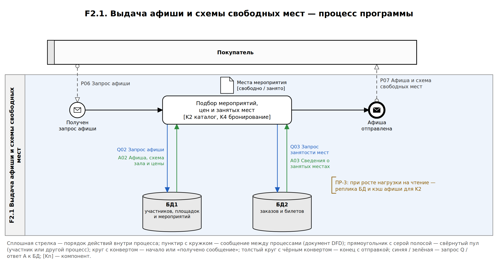

**F2.1. Выдача афиши [K2, K4].** По запросу (P06) читаются мероприятия и цены (Q02) и занятые места (Q03); покупателю уходит «Афиша и схема свободных мест» (P07).

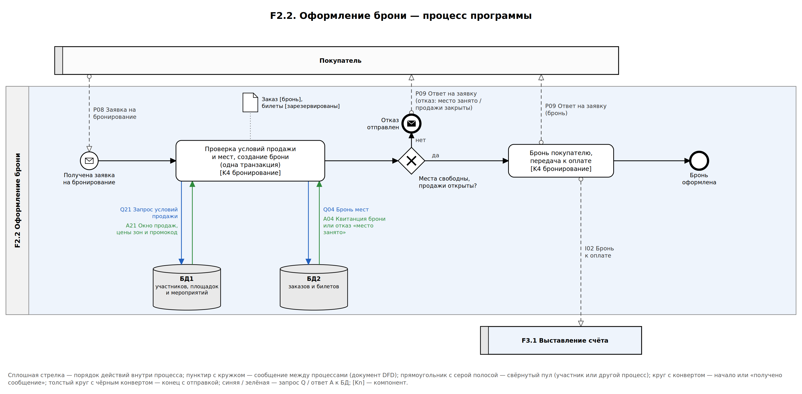

**F2.2. Оформление брони [K4].**
1. По заявке (P08) одной транзакцией заново читаются условия продажи (Q21) и делается попытка занять места (Q04): цена или промокод могли измениться после показа афиши.
2. Ромб «Места свободны, продажи открыты?» читает итог: одновременные заявки не дают двух броней — занятое место не пропускает уникальность в БД (R01).
3. «Нет» — отказ с причиной (P09); «да» — бронь покупателю (P09) и «Бронь к оплате» процессу F3.1 (I02).

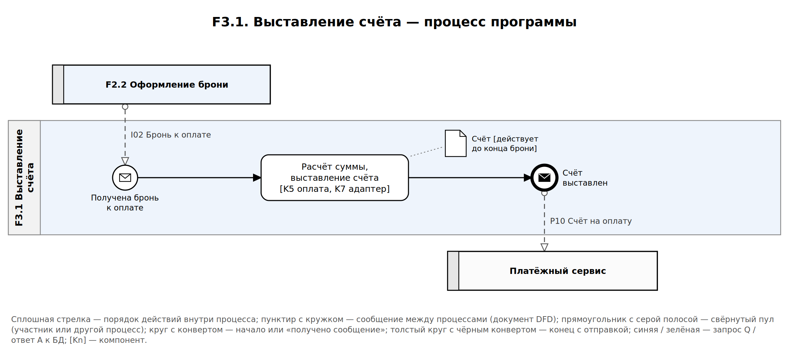

**F3.1. Выставление счёта [K5, K7].** По брони к оплате (I02) считается сумма Σ (цена − скидка) билетов, и адаптер отправляет платёжному сервису «Счёт на оплату» (P10). Оплата двухстадийная (R22): сервис только блокирует сумму, списывает по решению системы; счёт действует до конца брони.

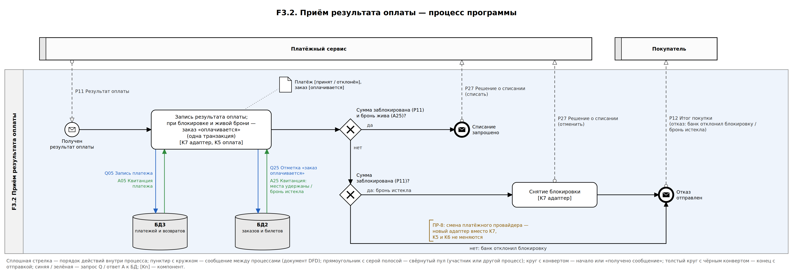

**F3.2. Приём результата оплаты [K7, K5].**
1. Результат оплаты (P11) записывается одной транзакцией: платёж «принят» или «отклонён» (Q05); если сумма заблокирована — заказ «оплачивается», но только при живой брони (Q25). Таймер не может вклиниться между проверкой брони и отметкой.
2. Ромб «Сумма заблокирована и бронь жива?» читает поле статуса P11 и ответ A25.
3. «Да» — «Решение о списании (списать)» (P27); билеты выдаст F3.3 после ответа «списано».
4. «Нет»: сумма заблокирована, но бронь истекла — «Решение о списании (отменить)» (P27), деньги не списываются; в любом «нет» покупателю — «Итог покупки» с причиной отказа (P12).

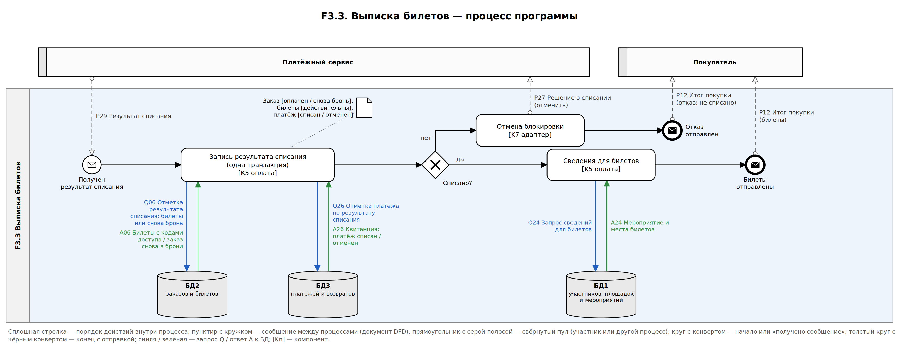

**F3.3. Выписка билетов [K5, K7].**
1. Ответ сервиса о списании (P29) записывается одной транзакцией: заказ и билеты (Q06), платёж (Q26). Списано — заказ «оплачен», билеты «действительны» с кодами доступа, платёж «списан»; не списано — заказ снова «бронь», платёж «отменён».
2. «Списано? — да»: читаются сведения для билетов (Q24), покупателю — «Итог покупки (билеты)» (P12).
3. «Нет»: сервису — «Решение о списании (отменить)» (P27), чтобы блокировка не висела на карте; покупателю — отказ «не списано» (P12); пока бронь жива, можно оплатить снова.

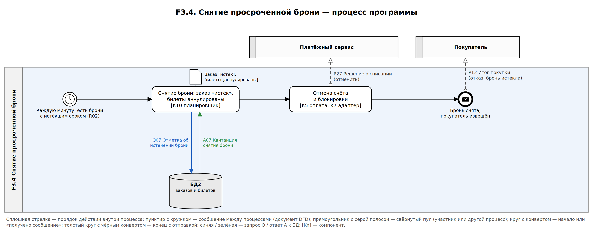

**F3.4. Снятие просроченной брони [K10, K5, K7].** Каждую минуту планировщик одной записью (Q07) переводит просроченные заказы «бронь» в «истёк», билеты аннулирует, места освобождает. Заказ «оплачивается» не трогается: место держится до ответа банка, а если ответ задерживается, адаптер переспрашивает исход по ID платежа. Затем сервису уходит отмена счёта и блокировки (P27), покупателю — «Итог покупки (отказ: бронь истекла)» (P12).

## 2.5. Согласование моделей

Таблица: Согласование моделей по функциям

<!-- include: generated/matrix.md -->

Модели согласованы между собой и проверены по правилам: баланс документов между уровнями DFD; каждый документ и обращение отнесены к листу; каждая сущность ER — ровно в одном хранилище, связь — там, где её внешний ключ; обращение приносит данные, нужные правилу; статус сущности меняет функция, которая пишет в её хранилище; каждое обращение к БД встречается в BPMN ровно один раз и выполняется одним компонентом архитектуры.
