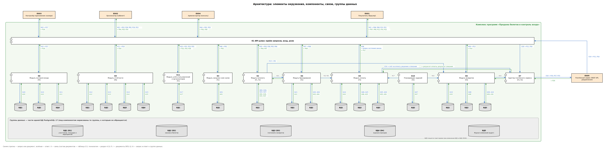
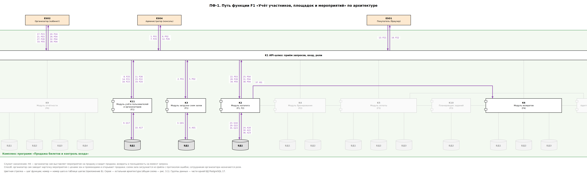
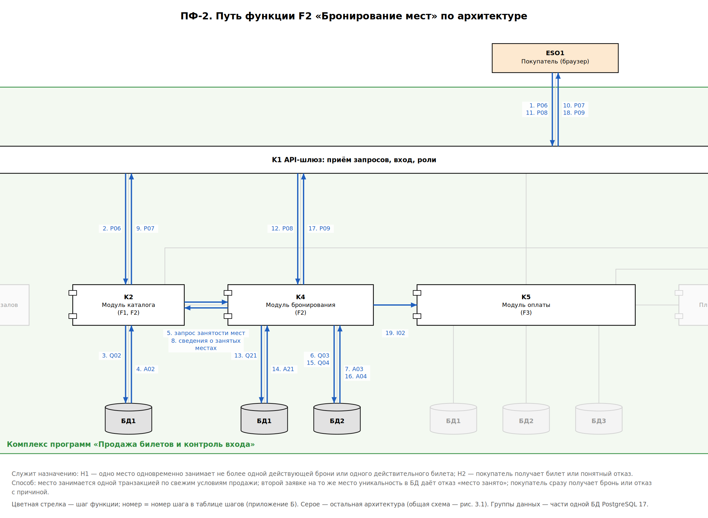
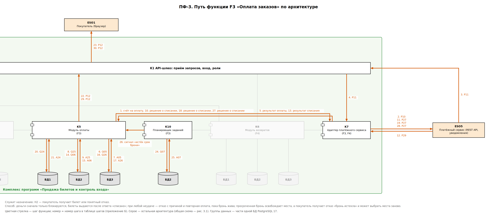
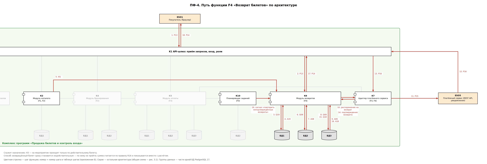
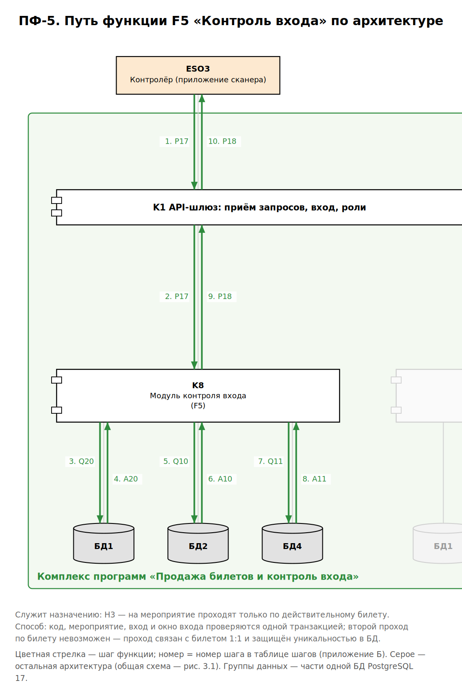
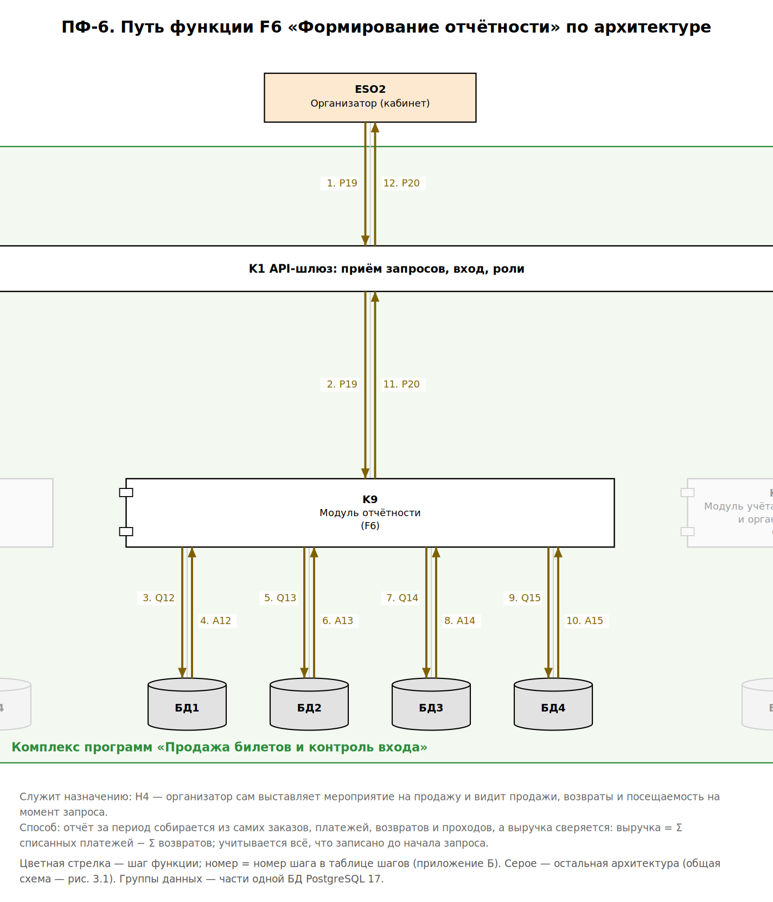

# 3. Облик и замысел: описание архитектуры

*Эскизный проект (ГОСТ 34.601-90, стадия 4; ГОСТ Р 57193-2025, п. 6.4.4). Описание архитектуры — ГОСТ Р 57100-2025 (пп. 3.1, разд. 6, 8).* Архитектура — элементы системного окружения, компоненты, связи, принципы функционирования и принципы развития. **Облик** — из чего состоит продукт (§3.1–3.3), **замысел** — каким способом он служит назначению (§3.4–3.6).

## 3.1. Заинтересованные стороны и схема

Таблица: Заинтересованные стороны и их интересы

| Сторона | Интересы |
|---|---|
| S1 Покупатель | C1 купить выбранные места без двойной продажи; C2 быстрый ответ в пик; C3 понятный возврат |
| S2 Организатор | C4 продажи и посещаемость в реальном времени; C5 отмена мероприятия одной операцией |
| S3 Контролёр | C6 мгновенная однозначная проверка билета |
| S4 Администратор | C7 загрузка схем залов без ручного ввода |
| S5 Разработчик | C8 замена СУБД или банка без переделки системы; C9 проверяемость правил |
| S6 Платёжный сервис | C10 однозначный счёт, идемпотентная обработка |

Точки зрения: состав и связи (§3.1–3.3), информационная (группы данных; §2.2, §4.4), поведенческая (§3.4), развитие (§3.5), технологическая (раздел 4).

- **ЭСО** = внешние сущности DFD: ESO1 покупатель (браузер), ESO2 организатор (кабинет), ESO3 контролёр (сканер), ESO4 администратор (консоль), ESO5 платёжный сервис (REST API, уведомления).
- **Группы данных** БД1–БД4 = хранилища D1–D4, БД5 — журнал изменений (пишут триггеры, R18); физически одна база PostgreSQL. Под компонентом нарисованы группы, к которым он обращается (синяя стрелка — Q, зелёная — A).
- **Связи** X01–X22: на каждой — документы (коды P, I) и технология (§3.3).

## 3.2. Компоненты и требования к ним

Компоненты выявлены по листьям дерева функций (§2.3.2) и действиям BPMN: за каждой группой операций стоит компонент, работающий с конкретными данными в отношении конкретного документа. Листья с общими данными и темой — один компонент (16 подфункций и листья F5, F6 → 8 модулей); отдельно выделены по природе работы шлюз K1, адаптер банка K7 и планировщик K10. Каждая пара Q/A выполняется ровно одним компонентом.

Таблица: Компоненты и требования к ним

| Компонент | Операции (листья) | Данные | Документы | Требования к компоненту |
|---|---|---|---|---|
| K1 API-шлюз | приём всех запросов людей и уведомлений банка; вход; проверка роли | — | все P от ESO1–ESO4; P11, P16 | HTTPS, REST, JSON (UTF-8); отказ 401/403 до бизнес-логики (R19); единый формат ошибки |
| K2 Каталог | F1.5–F1.7 карточка, публикация, отмена; F2.1 афиша | БД1: Q16, Q22, Q23, Q02 | P03–P07, P28; I01 → K6 | публикуется только черновик; отмена: статус мероприятия и возвраты (I01 → K6) — одной транзакцией |
| K3 Загрузка схем | F1.1 | БД1: Q01 | P01 → P02 | строка с ошибкой — в протокол, остальные загружаются (R20) |
| K4 Бронирование | F2.2; занятость мест для F2.1 | БД1: Q21; БД2: Q03, Q04 | P08 → P09; I02 → K5 | одна транзакция; места по возрастанию ID; промокод `FOR UPDATE`; ≤ 300 мс (NFR-01) |
| K5 Оплата | F3.1–F3.4 | БД1: Q24; БД2: Q25, Q06; БД3: Q05, Q26 | I02 → P12 | автомат состояний заказа (R07); билеты — только после «списано» (R22) |
| K6 Возвраты | F4.1–F4.3 | БД1: Q19; БД2: Q08; БД3: Q09, Q18 | P13 → P14; I01; P16 | сумма по R16; отмена мероприятия — одна транзакция (R17) |
| K7 Адаптер банка | обмен с платёжным сервисом для F3, F4 | — | P10, P27, P15 →; P11, P16, P29 ← | проверка подписи; ключ идемпотентности; повтор при сбое; при задержке ответа — переспрос исхода по ID платежа; смена банка — замена K7 |
| K8 Контроль входа | F5 | БД1: Q20; БД2: Q10; БД4: Q11 | P17 → P18 | одна транзакция; один проход на билет (R13); ≤ 100 мс (NFR-02) |
| K9 Отчётность | F6 | БД1–БД4: Q12–Q15 | P19 → P20 | только чтение основных таблиц на момент запроса; сверка выручки |
| K10 Планировщик | F3.4; повтор неподтверждённых возвратов | БД2: Q07 | сигналы K5, K6 | раз в минуту снимает только брони «бронь»; повторный запуск ничего не портит |
| K11 Пользователи и организаторы | F1.2–F1.4 | БД1: Q17 | P21–P26 | email уникален; пароль — только хэш; роли — только своему организатору |

## 3.3. Связи

На каждой связи — документы (их состав — §2.3.5, приложение А) и способ передачи; кодирование — JSON в UTF-8, деньги — десятичная строка с двумя знаками, время — ISO 8601.

Таблица: Связи архитектуры: документы и технологии передачи

<!-- include: generated/solution-links.md -->

## 3.4. Принципы функционирования

Принцип функционирования — **способ, которым функция служит назначению** (Н1–Н4, §1.1). Рисунок ПФ — участок общей схемы: путь функции выделен цветом, номер на стрелке — номер шага в таблице шагов (приложение Б); внизу рисунка — какому назначению служит функция и каким способом.

Таблица: Принципы функционирования: назначение и способ

<!-- include: generated/pf-summary.md -->

## 3.5. Принципы развития и решения

Таблица: Принципы развития

| ПР | Повод | Что меняется | Что не меняется |
|---|---|---|---|
| ПР-1 | рост данных и клиентов | SQLite → PostgreSQL (текущая) → реплики → распределённая БД | K2–K9: доступ через репозитории |
| ПР-2 | пиковые продажи | несколько экземпляров API за балансировщиком (nginx), «зал ожидания» | правила брони в БД |
| ПР-3 | нагрузка на афишу | реплика для чтения и кэш для K2 | бронирование — на основной БД |
| ПР-4 | рост журнала проходов | секционирование по месяцам, BRIN | K8, формат P17/P18 |
| ПР-5 | новые устройства | мобильное приложение поверх того же API | сервер |
| ПР-6 | новые отчёты | новые представления в K9 | остальные модули |
| ПР-7 | новые функции | перепродажа, лист ожидания — модули рядом с K4–K6 | существующие модули и данные |
| ПР-8 | смена банка | новый адаптер вместо K7 | K5, K6 |

**Решения и отвергнутые альтернативы** (ГОСТ Р 57100-2025, п. 6.6.1):
- A1 модульный монолит, а не микросервисы — один разработчик и одна БД; путь к ним — ПР-2, ПР-7;
- A2 одна физическая БД с логическими группами — иначе теряется транзакция «бронь → оплата → билеты»;
- A3 двойная продажа запрещена частичным уникальным индексом места — проверка в приложении не защищает от гонки;
- A4 удержание места строкой заказа с таймером, а не в Redis — лишний компонент для MVP;
- A5 правила-инварианты — в БД (ограничения, триггеры), сценарии — в приложении;
- A6 эмулятор платёжного сервиса вместо реального — проверка логики без внешней зависимости;
- A7 возврат денег: отметка в БД и распоряжения одной транзакцией, отправка после фиксации с повтором — распределённой транзакции с банком не бывает;
- A8 уведомления банка — через шлюз K1: один внешний адрес и одна проверка доступа.
