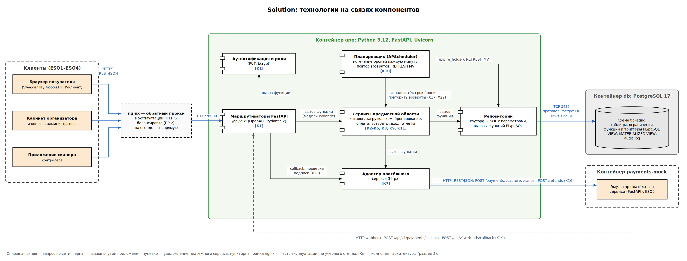

# 4. Solution: проектное (техническое) решение

*Технический проект (ГОСТ 34.601-90, стадия 5; ГОСТ Р 57193-2025, п. 6.4.5). Содержание — ГОСТ Р 59795-2021, пп. 5.2, 5.6.* Порядок: требования к компонентам (§3.2) → вариант построения → техническое воплощение → конструирование. Архитектура отвечает «что и как связано», Solution — «на чём и как именно»: по этому разделу программисту ставится задача.

## 4.1. Вариант построения и стек

Модульный монолит (одно приложение с компонентами K1–K11) + одна СУБД + эмулятор платёжного сервиса (решения A1–A8, §3.5).

Таблица: Технологический стек

| Слой | Технология | Почему |
|---|---|---|
| Язык и сервер | Python 3.12, FastAPI, Uvicorn | OpenAPI из кода; асинхронная обработка |
| Запросы и ответы | Pydantic 2, JSON (UTF-8) | проверка типов на границе API |
| Доступ к БД | Psycopg 3, SQL с параметрами, без ORM | все запросы видны; защита от SQL-инъекций |
| СУБД | PostgreSQL 17 | частичные уникальные индексы, PL/pgSQL, материализованные представления, BRIN |
| Инварианты | ограничения, функции, триггеры PL/pgSQL | правило работает при любом клиенте (A5) |
| Аутентификация | JWT (1 час, не хранится в БД), пароли — bcrypt | роли — из `organizer_members.role` и `users.is_admin` |
| Планировщик | APScheduler | снятие броней раз в минуту, обновление представлений |
| Платёжный сервис | эмулятор на FastAPI | двухстадийная оплата, отказы, повторные уведомления без внешней зависимости |
| Тесты | pytest | автотесты из ПМИ (§5) |
| Развёртывание | Docker Compose: `db`, `app`, `payments-mock`; секреты в `.env` | одна команда (NFR-07) |
| Обратный прокси | на стенде нет — клиенты идут в `app:8000`; в эксплуатации — nginx | HTTPS, балансировка экземпляров (ПР-2), лимит запросов; на стенде один экземпляр — упрощение |

## 4.2. Схема технического решения

Код по компонентам: `api/` — K1; `services/` — K2–K6, K8, K9, K11; `adapters/payments.py` — K7; `scheduler.py` — K10; `repositories/` — SQL; `sql/` — миграции, функции, триггеры, представления; `tests/` — автотесты ПМИ. Технология на каждой связи X01–X22 — таблица §3.3.

## 4.3. Классификатор запросов (REST API)

Пути начинаются с `/api/v1`; тело и ответ — JSON в UTF-8; аутентификация — `Authorization: Bearer <JWT>`. Типы: `int`; `decimal` — строка с двумя знаками; `datetime` — ISO 8601 с часовым поясом; `T?` — необязательно. Коллекции: `page`, `size ≤ 100`, `sort` → `{items, page, size, total}` (FR-19). Ошибка — `{error_code, message, details?}`; ошибки СУБД: 23505 → 409, 23514 и бизнес-правило → 422, 40001 и 40P01 → повтор до 3 раз, затем 409.

Таблица: Классификатор запросов REST API

| Код | Метод и путь | Роль | Аргументы (типы) | Ответ | Ошибки | Документ |
|---|---|---|---|---|---|---|
| API01 | `POST /auth/login` | все | `email: string`, `password: string` | `access_token: string`, `roles: string[]` | 401 | — |
| API02 | `GET /events` | все | query: `city: string?`, `category: string?`, `date_from: date?`, `date_to: date?`, `q: string?` + пагинация | `Page<EventShort{event_id: int, title: string, venue: string, starts_at: datetime, min_price: decimal}>` | 422 | P06/P07 |
| API03 | `GET /events/{event_id}` | все | `event_id: int` | `EventDetail{…, sales_start, sales_end, zones: [{zone_id: int, name: string, price: decimal}], artists: string[]}` | 404 | P07 |
| API04 | `GET /events/{event_id}/seats` | все | `event_id: int`, `zone_id: int?` | `[{seat_id: int, zone_id: int, row_no: int?, seat_no: int, price: decimal, state: "free"\|"taken"}]` | 404 | P07 (Q02, Q03) |
| API05 | `POST /orders` | покупатель | `event_id: int`, `seats: [{seat_id: int, holder_name: string}]` (1–10), `promo_code: string?`, `contact_phone: string?`, `contact_email: string?` | 201 `Order{order_id: int, status: "held", amount_due: decimal (вычисляется), discount: decimal, held_until: datetime, tickets: [{ticket_id: int, seat_id: int, price: decimal}]}` | 409 `SEAT_TAKEN`; 422 `SALES_CLOSED`, `PROMO_INVALID` | P08/P09 (Q21, Q04) |
| API06 | `GET /orders` | покупатель | `status: string?` + пагинация | `Page<Order>` | — | — |
| API07 | `GET /orders/{order_id}` | покупатель | `order_id: int` | `Order`: `status`; у оплаченного — билеты: `access_code: string`, мероприятие `event_title`, `starts_at`, место `row`, `seat_no`; при отказе — `reject_reason`: `declined` \| `not_captured` \| `expired` (причина последней неудачной попытки хранится в платеже). Так покупатель получает «Итог покупки»; чужой заказ — 404 без данных | 404 | P12 (Q24) |
| API08 | `DELETE /orders/{order_id}` | покупатель | `order_id: int` | 204 (бронь снята) | 409 `NOT_HELD` | — |
| API09 | `POST /orders/{order_id}/pay` | покупатель | `order_id: int` | `{payment_url: string, pay_until: datetime}` — ссылка на счёт, который F3.1 выставил сразу после брони (двухстадийный, `capture=false`, действует до конца брони, R22); повтор возвращает ту же ссылку | 403 (чужой заказ); 409 `HOLD_EXPIRED` | P10 |
| API10 | `POST /payments/callback` | платёжный сервис | `provider_txn_id: string`, `order_id: int`, `amount: decimal`, `status: "authorized"\|"failed"`, `signature: string` | 200 (повтор — без изменений). Блокировка и живая бронь → платёж `accepted`, заказ `paying`, затем `capture` (P27); ответ P29 — §2.4, F3.3 | 400 `BAD_SIGNATURE`; 409 `AMOUNT_MISMATCH` | P11 (Q05, Q25), P27, P29 (Q06, Q26, Q24) |
| API11 | `POST /tickets/{ticket_id}/refund` | покупатель | `ticket_id: int`, `reason: string?` | `Refund{refund_id: int, amount: decimal, status: string}` | 409 `ALREADY_REFUNDED`, `ALREADY_USED`; 422 `TOO_LATE` | P13/P14 (Q19, Q08, Q09) |
| API12 | `POST /checkins` | контролёр | `access_code: string`, `gate_id: int`, `event_id: int` (мероприятие, которое обслуживает контролёр), `device_id: string` | `{result: "allowed"\|"already_used"\|"refunded"\|"wrong_event"\|"wrong_gate"\|"outside_window"\|"invalid", holder: string?}` | 403 (у пользователя нет роли контролёра) | P17/P18 (Q20, Q10, Q11) |
| API13 | `POST /organizer/events` | менеджер | `title: string`, `venue_id: int`, `starts_at, ends_at, sales_start, sales_end: datetime`, `zones: [{zone_id: int, price: decimal}]`, `artist_ids: int[]` | 201 `EventDetail{status: "draft"}` | 409 `VENUE_BUSY`; 422 | P03 (Q16) |
| API14 | `POST /organizer/events/{event_id}/publish` | менеджер | `event_id: int` | `EventDetail{status: "published"}` | 409 (не черновик) | P28/P04 (Q22) |
| API15 | `POST /organizer/events/{event_id}/cancel` | менеджер | `event_id: int`, `reason: string` | `{refunded_tickets: int, refunded_amount: decimal}` | 409 `ALREADY_CANCELLED` | P05/P04 (Q23) → I01 |
| API16 | `GET /organizer/reports/sales` | менеджер | `event_id: int?`, `date_from: date`, `date_to: date` | `SalesReport{rows: [{event_id, day, sold: int, revenue: decimal, refunds: decimal, hold_conversion: decimal}]}` | 422 | P19/P20 (Q12–Q14) |
| API17 | `GET /organizer/reports/attendance` | менеджер | `event_id: int` | `{sold: int, checked_in: int, by_interval: [{t: datetime, n: int}]}` | 404 | P20 (Q15) |
| API18 | `POST /admin/venues` | администратор | `name: string`, `city: string`, `address: string`, `lat, lon: decimal?` | 201 `Venue` | 422 | P01 |
| API19 | `POST /admin/venues/{venue_id}/scheme` | администратор | файл CSV `zone, row, seat` | `ImportReport{batch_id: int, accepted: int, rejected: [{line: int, reason: string}]}` | 422 | P01/P02 (Q01) |
| API20 | `GET /admin/audit` | администратор | `table: string?`, `entity_id: int?` + пагинация | `Page<AuditRecord{at, user_id, table, op, old, new}>` | — | R18 |
| API21 | `POST /auth/register` | все | `email: string`, `password: string`, `full_name: string`, `phone: string?`, `birth_date: date?` | 201 `User{user_id: int}` | 409 `EMAIL_TAKEN`; 422 | P21/P22 (Q17) |
| API22 | `POST /admin/organizers` | администратор | `name: string`, `inn: string` (10 или 12 цифр), `manager_email: string` | 201 `Organizer{organizer_id: int}` | 404 (нет пользователя); 422 | P25/P26 (Q17) |
| API23 | `POST /organizer/members` | менеджер | `user_email: string`, `role: "manager"\|"controller"` | 201 `Member{user_id: int, role: string}` | 403 (чужой организатор); 404 | P23/P24 (Q17) |
| API24 | `POST /organizer/promo-codes` | менеджер | `code: string`, `discount_type: "percent"\|"fixed"`, `discount_value: decimal`, `valid_from, valid_to: date`, `max_uses: int?` | 201 `PromoCode{promo_id: int}` | 409 (код занят); 422 | P03 (Q16) |
| API25 | `POST /refunds/callback` | платёжный сервис | `refund_id: int` (ключ идемпотентности), `provider_refund_id: string`, `status: "done"\|"failed"`, `signature: string` | 200 (повтор — без изменений) | 400 `BAD_SIGNATURE` | P16 (Q18) |

## 4.4. Физическая схема БД

Изменения относительно ЛР 2 — миграцией с сохранением данных.

Таблица: Физическая схема БД

| Таблицы | Основное | Ключевые ограничения |
|---|---|---|
| `users`, `organizers`, `organizer_members` | пользователи (`password_hash`, `is_admin`), юрлица, роли | UNIQUE email; CHECK ИНН; CHECK role |
| `venues`, `venue_zones`, `seats`, `gates` | площадки, зоны, места, входы | UNIQUE (zone_id, row_no, seat_no) |
| `events`, `event_zones`, `artists`, `event_artists` | мероприятия с окном продаж, продаваемые зоны с ценой | CHECK sales_end ≤ starts_at < ends_at; CHECK цена > 0; триггер «зона ∈ зал» (R06) |
| `promo_codes` | промокоды организатора | срок, `max_uses` (R09, R21) |
| `orders` | `held / paying / paid / expired / cancelled`, `held_until` | триггер автомата состояний (R07) |
| `tickets` | цена, скидка, `access_code`, `reserved / active / used / refunded / void` | **частичный UNIQUE (event_id, seat_id) для живых билетов** (R01); UNIQUE access_code |
| `payments` | `accepted / captured / declined / cancelled`; выручка — только `captured` | UNIQUE provider_txn_id (R10) |
| `refunds` | распоряжение: билет, платёж, сумма, `pending / sent / done` | UNIQUE ticket_id (R15) |
| `ticket_checkins`, `scan_attempts` | проход; журнал сканирований | UNIQUE ticket_id (R13); BRIN по времени |
| `audit_log`, `import_batches`, `import_errors` | служебные | — |

- **Функции:**
  - `reserve_seats` — бронь одной транзакцией: места по возрастанию ID, промокод `FOR UPDATE`, сумма к оплате > 0;
  - `confirm_payment` — результат блокировки и списания; повтор с тем же ID платежа ничего не меняет, второй комплект билетов не создаётся; если ответ на `capture` задерживается, заказ остаётся `paying`, а K7 переспрашивает исход у сервиса по ID платежа (ключ идемпотентности);
  - `expire_holds` — снимает только `held` с истёкшим сроком; `paying` по сроку не снимается;
  - `refund_ticket` — сумма по R16;
  - `cancel_event` — одной транзакцией: статус мероприятия «отменено» (Q23), все действующие билеты «возвращены», брони сняты (Q08), распоряжения `pending` (Q09); K2 вызывает K6 внутри этой же транзакции (I01); отправка распоряжений банку — после фиксации, с повтором (A7); при ошибке не меняется ничего, включая статус;
  - `check_in` — условия входа и погашение одной транзакцией.
- **Триггеры:** автомат состояний заказа; окно продаж при вставке билета; «зона ∈ зал»; `used` при проходе; аудит `orders`, `tickets`, `event_zones`.
- **Представления:** `v_event_availability`, `v_active_holds`; `mv_sales_daily` — история продаж по дням (`REFRESH … CONCURRENTLY`). Отчёты API16, API17 читают основные таблицы и учитывают всё, что записано до начала запроса.
- **Роли БД:** `ticketing_owner` — миграции; `app_rw` — DML и EXECUTE без DDL; `report_ro` — чтение представлений.

## 4.5. Развёртывание

Таблица: Сервисы развёртывания

| Сервис | Образ | Порт | Настройки |
|---|---|---|---|
| `db` | `postgres:17` | 5432 | том `pgdata`; скрипты `sql/`; пароль из `.env` |
| `app` | `python:3.12-slim` | 8000 | `DATABASE_URL`, `JWT_SECRET`, `PAYMENTS_URL` из `.env`; Swagger UI `/docs` |
| `payments-mock` | `payments_mock/` | 8001 | режимы: успех, отказ, «не списано», повтор уведомления, задержка |

`.env` в репозитории нет, есть `.env.example`.
